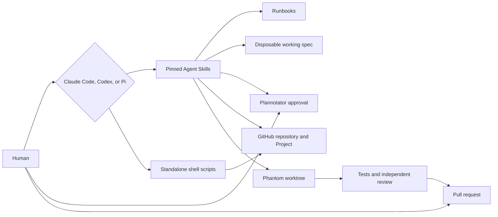

# Personal Software Factory Library Plan

## Goal

Build a small, portable software-factory library for turning a new idea into a
prepared GitHub repository, clarified work, reviewable implementation, and a
human-approved merge.

The library may contain multiple standalone shell scripts, selected Agent
Skills, and concise operational documentation. It is not limited to the current
setup script, and it does not need a monolithic factory CLI. Claude Code, Codex,
and Pi should be interchangeable execution harnesses where their capabilities
allow the same safety contract.

GitHub Issues and one GitHub Project hold durable work and status. Working
specifications stay beside the code in the active worktree and are disposable.
They are not required on the default branch, and no workflow may assume that a
specification file is committed or pushed. Phantom provides isolated worktrees.
Plannotator provides visual human-review gates. Every meaningful state change
remains human-gated.

## Operating principles

1. Ask the human to approve each workflow step before executing it.
2. Require explicit approval before publishing tracker items, committing,
   pushing, opening a pull request, merging, or deleting a worktree.
3. Prefer small, independently verifiable changes and direct end-to-end
   feedback.
4. Use the GitHub Project `Status` field as the lifecycle state. Use labels only
   for type or exceptional conditions.
5. Run implementation work in an isolated Phantom worktree.
6. Require tests, code review, security review, and enforced CI checks before
   merge handoff.
7. Prove one complete sequential path before adding parallel execution
   guidance.
8. Do not run an unattended issue-polling worker or automatic merger.
9. Do not use permission-bypass flags. Treat issue, pull-request, and external
   skill content as untrusted input.
10. Prefer existing, reviewed Agent Skills over locally reinventing their
    workflow.
11. Pin third-party skills and harness extensions to an audited revision,
    retain their license and attribution, and record every local compatibility
    patch or policy boundary.
12. Prefer a direct command in `README.md` over a wrapper. Add a script only when
    it provides a reproducible operation or removes a demonstrated repeated
    failure.

## Architecture



The initial setup script prepares only the repository and GitHub Project. Later
reproducible operations may receive separate scripts after their direct path and
contract have been approved. The library has no background service, custom
state store, automatic merger, or custom harness protocol.

### Source of truth

| Concern                         | Authoritative location                                           |
| ------------------------------- | ---------------------------------------------------------------- |
| Accepted intent and discussion  | GitHub issue                                                     |
| Provisional domain language     | GitHub issue or current planning session                         |
| Implemented domain language     | Code, tests, and public interfaces                               |
| Repeated unresolved terminology | Optional approved, scoped glossary                               |
| Lasting engineering decisions   | Versioned EDRs or ADRs                                           |
| Working specification           | Active worktree or current session, not required in Git history  |
| Implementation work             | GitHub tickets produced by the selected `to-tickets` skill     |
| Dependencies                    | Native GitHub blocking relationships when supported and verified |
| Lifecycle state                 | GitHub Project `Status` field                                  |
| Code under development          | One Phantom worktree per active ticket                           |
| Review result                   | Pull-request checks and review comments                          |
| Procedures and gates            | `README.md`, distributed scripts, and pinned skills              |

The working specification may be materialized as ignored Markdown so
Plannotator and a fresh session can read it. If the selected upstream skill
publishes the accepted specification to the tracker, the issue becomes its
durable copy. No step requires a specification file to reach the default branch.

## Distributable library

The intended final distribution contains only reusable artifacts:

```text
software-factory/
├── .gitattributes
├── .gitignore
├── README.md
├── pi-permissions.lock
├── skills.lock
├── config/
│   └── pi-permission-system.json
├── scripts/
│   ├── cleanup-ticket.sh
│   ├── install-pi-permissions.sh
│   ├── install-skills.sh
│   └── setup-factory.sh
├── test/
│   └── <crucial script tests and fakes>
└── skills/
    ├── setup-factory/SKILL.md
    └── <audited upstream skills>/
```

`docs/software-factory-plan.md` and `docs/software-factory-progress.md` are
development records. Keep them while building the library, but exclude them
from its installation or release bundle.

The disposable Python E2E project is a separate companion repository. For the
initial proof it is checked out at `/Users/zak/Desktop/scratch-project` and
published as `zzak00/scratch-project`. Its history is not part of the library.

## Upstream skill strategy

Use the open [Agent Skills specification](https://agentskills.io/specification)
as the portable format. Start from the MIT-licensed
[mattpocock/skills](https://github.com/mattpocock/skills) collection documented
by [AI Hero](https://www.aihero.dev/skills), rather than writing equivalent
planning and implementation skills from scratch.

The preferred main flow is:

```text
grill-with-docs -> to-spec -> to-tickets -> implement -> code-review -> plannotator-review
```

Include required dependencies such as `grilling`, `domain-modeling`, and `tdd`
when an adopted skill delegates to them.
Do not add an extra preflight skill unless a real end-to-end run demonstrates a
gap that the ticket approval and start-work checks cannot cover.

### Adoption rules

For each candidate skill:

1. Review the exact upstream source, transitive skill dependencies, scripts,
   license, tool permissions, file writes, network calls, commits, tracker
   mutations, and sub-agent behavior.
2. Run its direct workflow in the disposable Python repository with one
   harness, then verify the produced files and GitHub state.
3. Confirm it does not bypass the human gates in this plan.
4. Pin the accepted upstream commit and content hash in `skills.lock`.
5. Vendor the reviewed files for offline installation and retain upstream
   license and attribution in `README.md`.
6. Prefer an unmodified upstream skill. If a conflict remains, keep the patch
   minimal, record it in `skills.lock`, and test the changed behavior end to
   end.
7. Repeat the compatibility check in Claude Code, Codex, and Pi before claiming
   that skill is harness-neutral.

### Known upstream checks

The current AI Hero documentation identifies issues that must be resolved
before adoption:

- `setup-matt-pocock-skills` writes committed repository configuration and may
  edit `CLAUDE.md` instead of `AGENTS.md`. Do not adopt it as the factory
  bootstrap. Reuse only compatible ideas after review.
- `to-tickets` intends tracer-bullet tickets with native blocking edges, but
  its GitHub parent and blocking relationships have known failures. Verify the
  resulting GitHub relationships rather than trusting issue-body prose.
- `implement` commits automatically, does not open a pull request, and can run
  review before the diff is visible to that review. It cannot be shipped as-is
  while commit and review remain human gates.
- `code-review` can recursively spawn more review agents and its findings are
  hypotheses that require source verification. Disable unapproved delegation
  and run final review in a fresh session.

Other public spec-driven collections may be evaluated per capability. The
current alternatives found during research impose fixed `.specs` layouts,
generated rule files, or a different end-to-end model, so none currently
replaces the AI Hero chain as the primary baseline. This is a provisional
selection until the pinned source audit and E2E proof are complete.

## Harness-neutral use

Install each pinned skill into the harness's native skill directory without
overwriting an existing skill. The installation procedure must work from the
checked-out public library without fetching a private repository. A
compatibility note documents installation paths, dependencies, known
limitations, and native invocation syntax.

`grill-with-docs`, `grill-me`, `to-spec`, `to-tickets`, `implement`,
`code-review`, and `plannotator-review` are explicit user entry points.
Configure each harness so it cannot select an entry skill implicitly. Once the
user starts an entry flow, that skill may load only its documented internal
dependencies. Do not require separate manual invocations for `grilling`,
`domain-modeling`, or `tdd`.

Factory policy supplements upstream skills without duplicating their entire
instructions:

- ask for approval at the state-changing boundaries listed in this plan;
- read the target repository's own instructions before acting;
- use direct `gh`, `phantom`, `plannotator`, Git, and repository validation
  commands;
- never use dangerous or permission-bypass flags;
- preserve command output needed as verification evidence;
- stop on ambiguity or a failed gate;
- never merge automatically;
- never launch a sub-agent swarm without explaining the tradeoffs and receiving
  explicit approval.

Initial Claude and Codex non-interactive command shapes are:

```text
Claude Code: phantom exec <worktree> claude --print --input-format text --output-format stream-json --no-session-persistence
Codex:       phantom exec <worktree> codex exec --sandbox workspace-write --ephemeral --json -
```

Pi workflows are interactive because the user invokes the entry skill and
answers the permission extension's command prompts:

```text
Implementation: phantom exec <worktree> pi --no-session --tools read,edit,write,bash,grep,find,ls
Review:         phantom exec <worktree> pi --no-session --tools read,bash,grep,find,ls
```

Pi must use the exact extension and global policy pinned in
`pi-permissions.lock`. The extension is a fail-closed decision layer rather
than OS isolation. Review omits direct mutation tools and every Bash command
requires human approval; approve only exact read-only Git commands and the
privacy-restricted Plannotator process. If an installed version cannot honor
the required contract, stop and report the incompatible prerequisite.

## Board design

Create one GitHub Project per target repository with this `Status` field:

| Status          | Meaning                                                  | Entry condition                                                      |
| --------------- | -------------------------------------------------------- | -------------------------------------------------------------------- |
| Triage          | New item needs a decision                                | Item is added                                                        |
| Planning        | Requirements are being clarified                         | Human starts planning                                                |
| Spec Ready      | The intended change is approved                          | Human approves planning output                                       |
| Ready for Agent | Approved executable work is waiting to be claimed        | Initial scope or review rework is approved and blockers are resolved |
| In Progress     | An agent owns the current implementation or rework round | A clean worktree is created or reused and claimed                    |
| In Review       | Pull request is ready                                    | Required checks and reviews are ready for human review               |
| Done            | Work is complete or closed                               | Issue closes                                                         |

Use only these initial labels:

- `factory:spec` for an issue carrying an accepted specification;
- `needs-info` when planning cannot continue without input;
- `wontfix` when an issue is intentionally rejected.

Do not duplicate statuses as labels.

Configure these GitHub Project workflows in the web UI when GitHub exposes no
supported creation mutation:

1. When an item is added, set `Status` to `Triage`.
2. When an issue is closed, set `Status` to `Done`.

## Initial apply pass

`scripts/setup-factory.sh` creates or validates only:

1. a local Git repository when absent;
2. the exact GitHub repository and `origin` remote;
3. one exact-title private GitHub Project;
4. the Project-to-repository link;
5. the seven built-in Status options;
6. one Kanban board view;
7. the three initial labels.

It does not install later workflow artifacts, write target-repository policy
files, commit, push, create rulesets, enable security settings, configure
Project workflows, or execute planning and implementation skills.

## Planning and approval flow

Follow the `README.md` planning section. It defines two intake paths:

1. Bugs and bounded changes receive only the clarification needed to establish
   expected behavior and an observable verification seam.
2. Big or unclear ideas remain in `Planning` while `grill-with-docs` develops
   the design tree, durable domain language, important EDRs or ADRs, and an
   approved set of outcome-oriented sub-ideas.

Promote the smallest coherent sub-idea rather than turning the whole idea into
one implementation ticket. Use a disposable working specification only when
cross-session coordination or visual review needs it. Run `to-tickets` only
when one approved sub-idea is too large for one implementation session.

Ask separately before status changes, durable documentation, specification
publication, ticket creation, and GitHub relationships. The selected upstream
skills define planning content. The factory adds no fixed specification
template or mandatory issue hierarchy.

## Ticket readiness

There is no standalone preflight artifact or preflight comment in the initial
flow. Before implementation, perform a short read-only check that the ticket:

- is open and in `Ready for Agent`;
- has no unresolved native blocker;
- identifies the expected behavior and an observable verification seam;
- is scoped for the current implementation session;
- points to any working spec or accepted discussion needed for context.

If any check fails, stop and return the item to planning. Add a separate
preflight process only if repeated E2E failures show that this lightweight gate
is insufficient.

## Implementation and review flow

For one approved, ready ticket:

1. Read the ticket, accepted discussion or working spec, dependencies,
   repository instructions, and authoritative Project status.
2. Perform the ticket-readiness check and stop on any unresolved ambiguity.
3. Ask permission to claim it.
4. Assign the current user and create the worktree:

   ```bash
   phantom github checkout <issue-number> --base <default-branch>
   ```
5. Move it to `In Progress` only after worktree creation succeeds.
6. Start a fresh safe harness session in the worktree using the documented task
   contract.
7. Reproduce the behavior from the user's perspective.
8. Drive the change test-first at the agreed observable seam.
9. Run formatting, lint, type checking, focused tests, and the relevant E2E
   check. Run the complete suite once at the end.
10. Ask before creating the implementation commit.
    On rework, report both the current round's starting `HEAD` and the original
    review fixed point. The writable session must refuse to perform or delegate
    review after the commit.
11. Start a fresh read-only session and manually invoke `code-review`. Infer
    the issue from the issue branch and the original fixed point from Git's
    branch-creation record, cross-checked against the default-branch merge
    base. Stop for an explicit value when inference is ambiguous, and never
    substitute merely the latest correction commit.
12. After the automated report, the human may manually invoke
    `plannotator-review` from that review session. It runs Plannotator through
    the harness terminal tool and waits so feedback returns to the model for
    verification. Never use the raw Codex shell escape for this gate. Feedback
    does not authorize edits or external mutations by itself.
13. If feedback requests a product-scope change, ask the decision question in
    the same review session. When approved and fully defined, propose the exact
    issue-intent update and rework packet. Require one testable expected
    behavior without another product decision; ask again rather than inventing
    missing values, mappings, defaults, compatibility, or error behavior. If
    intent remains unclear, return the item to `Planning`. For an in-scope
    correction, ask before persisting a
    rework packet with the accepted findings, original base, reviewed commit,
    and validation commands.
14. After the packet is verified, ask before moving the item back to `Ready for Agent`. Keep the same clean branch and worktree. The next harness claims it,
    returns it to `In Progress`, runs `implement`, and repeats the full review
    from the original base.
15. If the human approves the diff, ask permission to push and open one pull
    request for the ticket.
16. Wait for required CI and security checks.
17. Move the issue to `In Review` only when it is ready for human review.
18. Present the pull-request URL and manual `plannotator-review` invocation.
19. The human reviews, chooses the method documented in `README.md`, verifies
    the reviewed head commit, and
    explicitly approves the merge.
20. Verify the issue and Project status reflect completion.
21. Inspect with `scripts/cleanup-ticket.sh`, then ask before applying local
    cleanup and separately including remote branch deletion.

Never create a separate checkout merely because review requested changes.
Never delete a worktree containing uncommitted or unpushed work. A harness on
the same machine reuses it; another machine requires an approved branch push
and a separate checkout.

## Merge-gate policy

Every target repository protects its default branch with a GitHub ruleset:

1. default-branch changes require a pull request;
2. force pushes and branch deletion are blocked;
3. required build, lint, typecheck, unit, and E2E checks pass;
4. configured dependency-review and code-security checks pass, or a named human
   exception is recorded;
5. secret scanning or push protection is enabled where available;
6. bypass permission is restricted to named maintainers and audited;
7. team repositories require at least one eligible human approval.

For a solo repository, do not require an approval the sole maintainer cannot
provide. Plannotator review and the manual merge decision remain mandatory.

## Build and verification plan

### Phase 1: Verify prerequisites

- Verify `gh`, Phantom, Plannotator, Claude Code, Codex, and Pi versions.
- Verify GitHub authentication includes the `project` scope.
- Verify `PLANNOTATOR_SHARE=disabled` and no global Plannotator exit hook.
- Record safe non-interactive harness commands.
- Record any explicit human-accepted deviations.

### Phase 2: Prove the direct setup path

- Use the separate `scratch-project` companion checkout to create a private
  disposable Python repository with a passing CI check.
- Follow the `README.md` setup section one approved step at a time.
- Preserve commands, expected results, failures, and corrections in the
  development progress tracker.
- Do not automate a transition until its direct command has worked once.

### Phase 3: Build the initial apply artifacts

- Maintain the standalone, idempotent setup script with inspect and apply modes
  and no destructive operation.
- Keep its scope limited to initial repository and Project state.
- Maintain the installation and setup sections in `README.md`.
- Verify idempotency manually in the scratch repository.

### Phase 4: Audit and adopt upstream planning skills

- Audit and pin the smallest dependency-complete subset of AI Hero skills for
  grilling, specifications, tickets, and test-first implementation.
- Do not write replacements for behavior already provided upstream.
- Decide and document disposable working-spec storage through a direct E2E run.
- Verify Plannotator feedback, cancellation, ticket publication approval, and
  native GitHub blocker relationships.
- Record provenance and any minimal compatibility patches.

### Phase 5: Complete implementation and review operations

- Resolve the upstream `implement` commit/review ordering conflict while
  preserving human approval.
- Adapt `code-review` into a sequential, read-only explicit entry and prove the
  automated-review, Plannotator-feedback, and rework-handoff loop.
- Vendor the pinned upstream `plannotator-review` entry so annotations return
  to the active review session without installing global hooks.
- Pin and install Pi's fail-closed permission gate before enabling Bash, and
  document that it is a decision layer rather than OS isolation.
- Validate one complete ticket with each safe harness command shape.
- Add separate scripts only for reproducible operations demonstrated to need
  them.
- Complete two sequential real tickets before documenting parallel execution.

### Phase 6: Add optional parallel guidance

Only after two sequential tickets pass, document how to select independent
tickets and launch one agent in each isolated worktree. A wave is a fixed set
of open, approved, unblocked `Ready for Agent` tickets with no dependency path
or overlapping change ownership between them. Dependent tickets wait for a
later unblocked frontier. Support separately started sessions and explicitly
requested bounded workers, but do not add a swarm harness, automatic scheduler,
worker refill, or automatic ticket discovery. Explain tradeoffs and ask for
explicit approval before every multi-agent execution wave.

### Phase 7: Package and adopt

- Add the concise operator guide, compatibility matrix, installation
  instructions, privacy defaults, third-party attribution, and recovery index
  to `README.md`.
- Exclude the development plan and progress tracker from the distribution.
- Validate every relative link and shell snippet.
- Confirm each advertised skill is discoverable and safe in Claude Code, Codex,
  and Pi.
- Test installation from a fresh public checkout without private dependencies.
- Adopt the library in one real repository.
- Remove disposable GitHub resources only after preserving evidence and
  receiving explicit approval.

## Final verification checklist

- [ ] The release is a portable library of scripts, pinned skills, and docs.
- [ ] Development-only plan and progress files are excluded from installation.
- [ ] Initial setup is idempotent and limited to its documented apply pass.
- [ ] Third-party skills have pinned provenance, hashes, license notices, and
  audited permissions.
- [ ] The main workflow reuses proven upstream skills instead of local rewrites.
- [ ] Working specs stay with active code and are not required in Git history.
- [ ] No fixed specification template or mandatory issue hierarchy is imposed.
- [ ] Human approval is required at every state-changing workflow boundary.
- [ ] Published tickets and native blocker relationships match the approved
  proposal.
- [ ] Ticket readiness is checked without a separate preflight artifact.
- [ ] Project statuses match actual work state.
- [ ] One active ticket maps to one isolated worktree and pull request.
- [ ] Tests and independently verified code and security reviews run before
  handoff.
- [ ] A ruleset blocks direct default-branch changes and failing merges.
- [ ] Plannotator reviews working specifications and pull-request diffs.
- [ ] Cleanup preserves unmerged or unpushed work.
- [ ] Every claimed harness is covered by an actual compatibility run.
- [ ] Pi's permission extension, resolved dependencies, and global policy are
  pinned and independently verifiable.
- [ ] No polling worker, automatic merger, global review hook, or factory-owned
  permission bypass is required.

## Deferred extensions

Do not include these in the initial library:

- unattended issue polling or automatic agent pickup;
- a monolithic CLI, background service, state store, dashboard, or control
  plane;
- custom harness protocols;
- Phantom MCP integration;
- global plan-exit hooks;
- terminal-specific Plannotator surfaces;
- automatic merging;
- swarm or large multi-agent execution harnesses.
