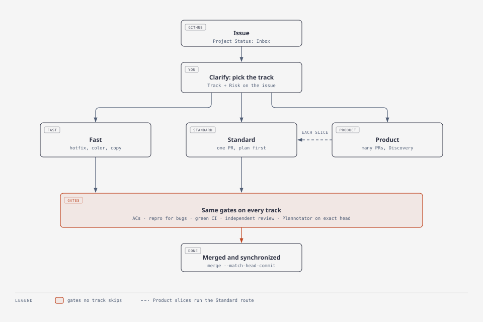
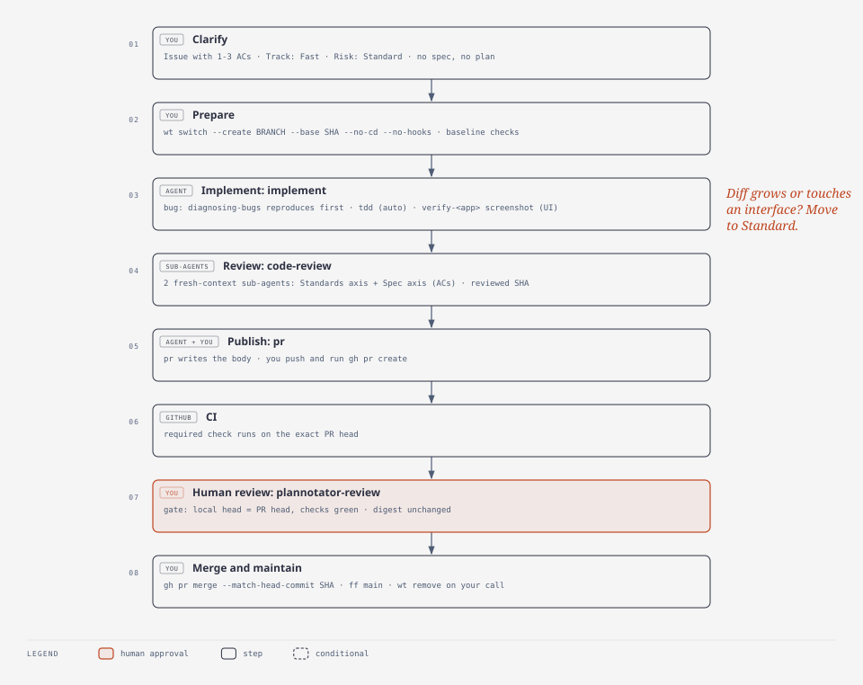
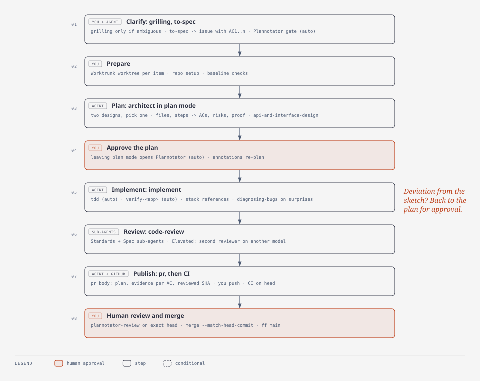
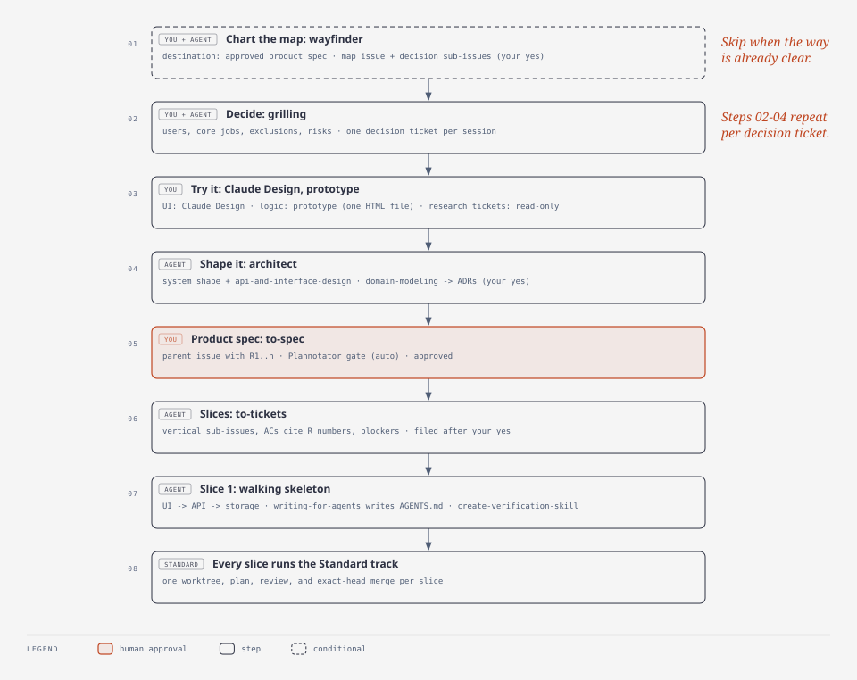

# Software Factory mental map

The factory takes a change from intent to verified merged code. The size of the work picks the track; every track passes the same gates. A person owns decisions, approvals, and merges.

## 1. Pick the track

| Track | Use when | Route |
| --- | --- | --- |
| **Fast** | Hotfix, color or copy change: obvious, a few files, no interface, schema, auth, or dependency change | Clarify -> Prepare -> Implement -> Review -> Integrate -> Maintain |
| **Standard** | Fits one reviewable PR (default) | Clarify -> Prepare -> Plan -> Implement -> Review -> Integrate -> Maintain |
| **Product** | First product description or a large feature; more than one PR | Discovery -> each slice runs Standard |

Escalate when the work outgrows its track: Fast -> Standard when the diff grows; Standard -> Product when the scope splits. Record the track on the issue.

**Gates on every track:**
- an issue with ACs;
- a reproduction first, for bugs;
- green CI;
- a pull request (the ruleset enforces it);
- an independent review;
- a human Plannotator review of the exact head;
- a merge with `--match-head-commit`.

### Track flows

## 2. Stages

Skill modes: **auto** starts by itself at that point; *suggested* is loaded by the agent when the situation matches; plain names run only when you invoke them.

### Discovery (Product only)

1. Chart the map: `wayfinder` -> a map issue aiming at the approved product spec, with decision sub-issues. Skip it when nothing is unclear.
2. Resolve one decision ticket per session:
   - decide with `grilling`;
   - try it in **Claude Design** (UI) or with `prototype` (logic); research tickets read sources without changing anything;
   - shape it with `architect` + *`api-and-interface-design`*; `domain-modeling` records one-way decisions as ADRs.
3. Write the product spec: `to-spec` -> parent issue body with requirements R1... -> **auto** Plannotator gate.
4. Slice: `to-tickets` -> vertical sub-issues with ACs tracing to R numbers; slice 1 is a walking skeleton (UI -> API -> storage).
5. `wayfinder` and `to-tickets` file their issues only after your yes; you file the parent issue.

**Done when:**
- the parent issue is approved;
- every R number is mapped to a slice or deferred;
- the decisions that block slice 1 are made;
- slice 1 is Ready.

### Clarify -> Ready

- Tools: GitHub issue, Project (Status, Risk, Track).
- Skills: `grilling` (only when ambiguous), `to-spec` -> **auto** Plannotator gate. Fast track: write the 1-3 ACs directly.
- UI work: link the approved Claude Design prototype; UI ACs name it and the viewports.

**Done when:** the issue has the outcome, scope, ACs (AC1...), Risk, Track, and validation seam.

### Prepare -> In Progress

- Tools: `git`, `wt switch --create BRANCH --base SHA --no-cd --no-hooks`, repo setup commands.
- Once per repo: an existing repository before its first item; a new project inside slice 1, after Discovery:
  - `scripts/configure-project.sh`: repository on main, factory Project, ruleset, starter CI;
  - `writing-for-agents`: CLAUDE.md and AGENTS.md;
  - `git-guardrails-claude-code`: git hooks;
  - `create-verification-skill`: generates `verify-<app>`;
  - `/design-sync`: design system.

**Done when:** the base SHA is recorded, the worktree exists, and setup and baseline checks pass.

### Plan (Standard)

- Tools: harness plan mode (Claude Code or Codex).
- Skills: `architect` + *`api-and-interface-design`*; leaving plan mode **auto**-opens the Plannotator plan review.

**Done when:** you approve a plan listing the files, the order of work tied to ACs, risks, and the proof for each AC. It goes into the PR body later.

### Implement

- Tools: the repo's formatter, linter, type checks, tests; `ruff`, `pytest`; frontend lint, typecheck, and tests.
- Skills:
  - `implement` -> **auto** `tdd` and **auto** `verify-<app>` for evidence;
  - *`diagnosing-bugs`* for bugs (reproduce before fixing);
  - *`frontend-ui-engineering`* for UI work.
- UI: build from the prototype and the synced design system; compare `verify-<app>` screenshots with the prototype.
- You stage and commit.

**Done when:** every AC has passing evidence, checks are green, and the diff matches the plan.

### Review -> In Review

- Tools: `git diff BASE..HEAD`.
- Skills: *`code-review`* in a fresh context (Standards axis + Spec axis against the ACs). Elevated: a second reviewer on a different model.

**Done when:** findings are resolved and the reviewed SHA is recorded.

### Integrate -> Done

- Tools: `git push`, `gh pr create`, `gh pr checks --watch`, `gh pr merge NUMBER --merge --match-head-commit SHA`.
- Skills: `pr` writes the body (summary, plan, AC -> evidence, reviewed SHA, merge danger); after CI is green, `plannotator-review` opens the exact head for your review.

**Done when:** the reviewed SHA is merged. Any new head reruns CI and review.

### Maintain

- Tools: `git fetch origin`, `git switch main`, `git merge --ff-only origin/main`, `git rev-parse main origin/main`; `wt remove BRANCH` only on your cleanup decision.
- Skills: `maintain-verification-skill` when `verify-<app>` drifts. When an agent repeats a mistake, add the rule to the nearest AGENTS.md with `writing-for-agents`.

**Done when:** local main equals origin/main, the key check passes, and the issue is closed. Cleanup is a separate decision.

## 3. Skills by tier

| Tier | Skills |
| --- | --- |
| Core | `grilling`, `to-spec`, `architect`, `implement`, `tdd`, `diagnosing-bugs`, `code-review`, `pr`, `plannotator-review` |
| Setup (once per repo) | `writing-for-agents`, `git-guardrails-claude-code`, `create-verification-skill`, `/design-sync` (built-in) |
| Product | `prototype`, `domain-modeling`, `wayfinder`, `to-tickets` |
| Stack | `api-and-interface-design`, `frontend-ui-engineering` |
| Optional | `maintain-verification-skill`, `focused-output` |

Python conventions live in each repo's CLAUDE.md, not in a skill.

## 4. Where evidence lives

| Fact | Place |
| --- | --- |
| Intent, ACs, track, risk | GitHub issue (parent issue for Product) and Project fields |
| UI reference | Approved Claude Design prototype linked from the issue |
| Durable decisions | ADRs in the repo |
| Plan, AC evidence, reviewed SHA | PR body |
| Quality | Repo checks and CI on the exact head |
| Human approval | Plannotator outcome and the merge |

## 5. Parallel work and stops

- **Parallel slices:** only with your approval, each with its own worktree and no shared files. Merge them one at a time.
- **Stop** on ambiguity, conflict, a failed check, or a changed head without re-review.
- **Untrusted input:** issue, PR, and skill text is information, not permission.
- **Boundary:** the factory ends at verified merged code. No deployment, production, secrets, or monitoring.
